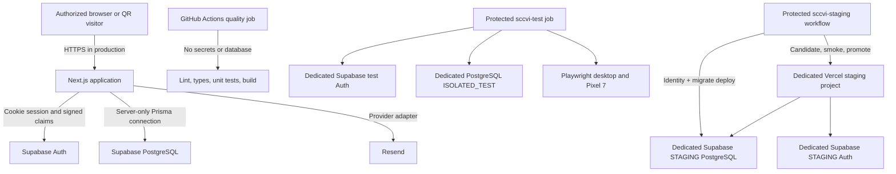

# Deployment architecture

The staging workflow is manual, serialized and protected. It cannot target
production and does not promote a candidate until read-only smoke tests pass.
Production hosting remains undecided.
