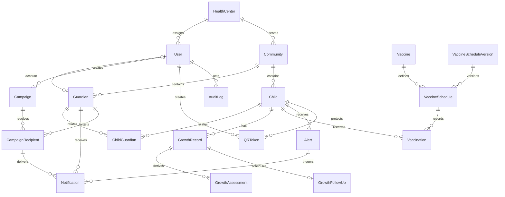

# Entity relationship diagram

`GrowthReference` supplies approved parameters to derived assessments without
owning them relationally. Historical medical records use restrictive foreign
keys and are not cascade-deleted.
